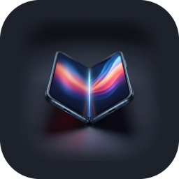
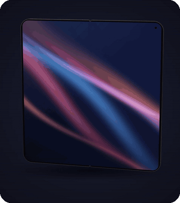
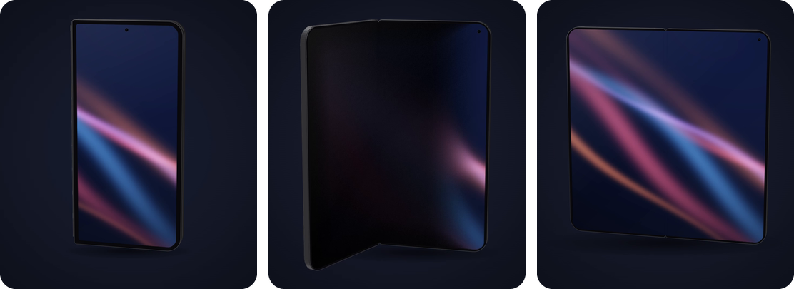
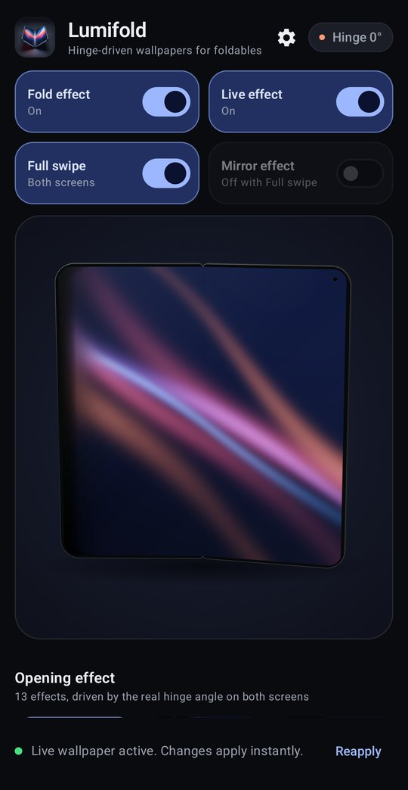
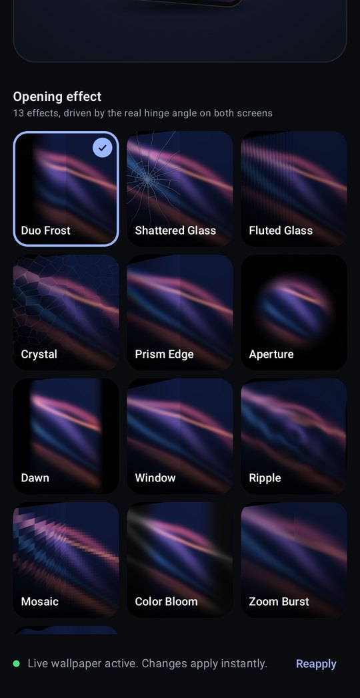
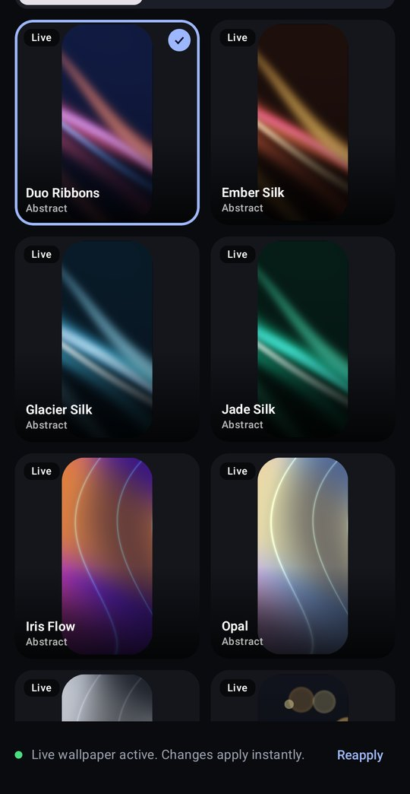
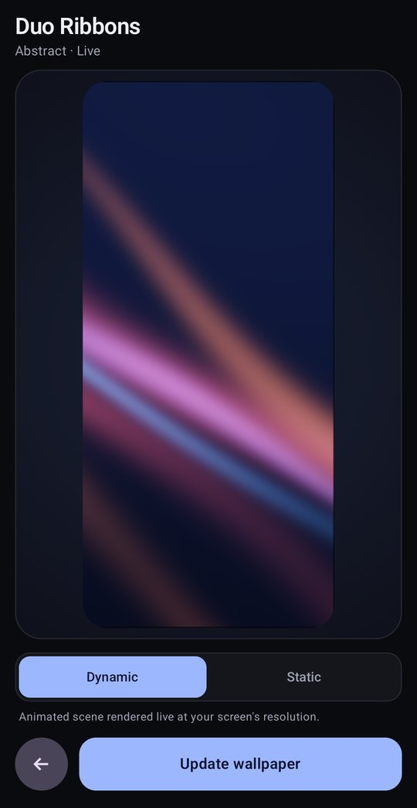
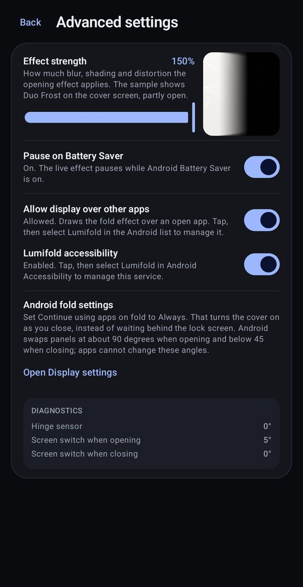
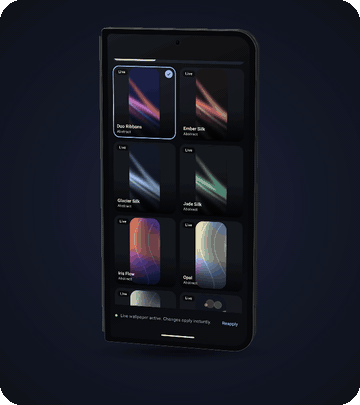

<p align="center">
  
</p>

<h1 align="center">Lumifold</h1>

<p align="center">Hinge-driven live wallpapers for book-style Android foldables<br>
<a href="https://github.com/bendourthe/lumifold/releases/latest">Download the latest APK</a></p>

<p align="center">
  
</p>

Live wallpaper for book-style Android foldables (Pixel Fold, Pixel 9 Pro Fold and later). It recreates the iPhone Duo frosted-glass opening effect, adds twelve more hinge-driven transitions, and brings every wallpaper to life with slow, natural motion. Each frame maps the real hinge angle to an AGSL shader, so the effect follows your hand instead of playing a canned animation.

## Features

<p align="center">
  
  <br><sub>Closed on the cover, opening with Full swipe still covering the inner screen, and fully open</sub>
</p>

- **Thirteen opening effects**: Duo Frost, Shattered Glass, Fluted Glass, Crystal, Prism Edge, Aperture, Dawn, Window, Ripple, Mosaic, Color Bloom, Zoom Burst and Silk Wave. A critically damped spring smooths the hinge so the effect glides through the sensor's steps.
- **Duo Frost**: the iPhone Duo model, following Apple's own demo as reverse-engineered by [juejin](https://juejin.cn/post/7688737629098999843) and the [Empirical Health](https://www.empirical.health/blog/why-iphone-duo-fold-animation-works/) reconstruction. Both displays sample one fixed picture behind the glass; as a panel lifts, blur and shade grow toward its free edge until it falls into black, and rays that miss the picture show black wedges.
- **Full swipe** (on by default): a soft front crosses each screen from right to left. The cover is dimmed and blurred behind it until it is fully covered at 90 degrees, and the inner screen lights fully covered and clears by flat. Closing plays it back, and the picture never moves.
- **Each screen matches its own range**: opening hands over to the inner screen at 90 degrees and closing hands back to the cover near 45 degrees, with the full effect on both sides of each switch.
- **Hold and finish**: a hinge held still keeps the effect for 2 seconds, then finishes it over 1.2 seconds; folding back the other way starts a new fold. After a close, the cover comes up covered and reveals the wallpaper by itself.
- **Effect over apps** (optional): with an app open, a soft dimming sweep follows the fold on both screens, drawn live without screenshots. The app offers to set it up on first launch. See [Effect Over Apps](#effect-over-apps).
- **Live effect**: generative designs animate natively, abstract photos flow like slow liquid glass, and landscapes, cities and space scenes play real video loops. Turn the live effect off to show each design's still poster.
- **234 designs in eleven categories**: GPU-rendered generative scenes at the display's native resolution, photographs, and 63 video loops hosted on the project's `media-v1` release and downloaded on demand.
- **Home page toggles**: Fold effect, Live effect, Full swipe and Mirror effect (both halves move; off by default, and unavailable while Full swipe is on). Advanced settings hold effect strength (25 to 150 percent), Pause on Battery Saver, the permissions for the effect over apps, and diagnostics.
- **Cover display stays on while opening** (Android 16 and later). See [Cover Display](#cover-display).
- **Diagnostics**: the app reports the live hinge angle and the angles at which your device switched displays.

## Screenshots

<table>
  <tr>
    <td align="center"><br><sub>Home page</sub></td>
    <td align="center"><br><sub>Opening effects</sub></td>
    <td align="center"><br><sub>Wallpaper gallery</sub></td>
    <td align="center"><br><sub>Wallpaper detail</sub></td>
    <td align="center"><br><sub>Advanced settings</sub></td>
  </tr>
</table>

## What's New in 0.5.2

- The 3D preview on the home page keeps animating after the screen turns off and the phone is unlocked.
- This README now shows the app, the fold and the effect over apps.

Earlier releases: [CHANGELOG.md](CHANGELOG.md).

## Cover Display

Android decides which display is on, not the wallpaper. On Android 16 and later, book-style foldables that use `BookStyleDeviceStatePolicy` switch to the inner display as soon as the hinge moves, unless a screen wake lock is held; then the device stays CLOSED (cover on) until about 90 degrees. Lumifold holds that lock as part of the fold effect: the wallpaper holds it on Home, and the accessibility service holds it over apps. The lock is re-armed by touches and expires one second before your screen timeout. When closing, Android hands over to the cover below about 45 degrees, and no app can change either angle. On older Android versions the system switches immediately; the inner display still runs its half of the effect.

`FLAG_KEEP_SCREEN_ON` only applies to a foreground activity window, and `WindowAreaController` (rear display and dual screen) only works for a foreground activity on an already-open device, so neither can serve a home-screen wallpaper.

## Effect Over Apps

On Home, the wallpaper draws the effect itself. Over an app, the optional Lumifold accessibility service and the "display over other apps" permission draw a dimming sweep above the app while the hinge moves. The app offers to set both up on first launch, and Advanced settings keep the switches. Lumifold takes no screenshots and does not read window content. Android can blur another app only in uniform rectangles, whose hard edges would cut across the sweep, so apps are dimmed rather than blurred.

<p align="center">
  
  <br><sub>Rendered with the 3D preview's geometry and the app's dimming formula, at the default strength with Full swipe on</sub>
</p>

## Build

Requirements: JDK 17 and the Android SDK (compile and target SDK 37). The minimum Android version is 13 (API 33) for AGSL.

```powershell
.\gradlew.bat testDebugUnitTest assembleDebug
```

The APK is written to `app\build\outputs\apk\debug\app-debug.apk`. Install it, open Lumifold, pick an opening effect, tap a wallpaper, then tap **Apply**.

A signed release build reads `keystore.properties` at the repository root (git-ignored, holding `storeFile`, `storePassword`, `keyAlias` and `keyPassword`); without it, `assembleRelease` produces an unsigned APK.

## Project Layout

```
app/src/main/java/com/lumifold/wallpaper/
  model/     WallpaperItem, OpeningEffect, WallpaperRepository (catalog and preferences)
  render/    FoldShaders (AGSL), FoldOptics (geometry spec), BlurPyramid, WallpaperShader, VideoFrames, ShaderSnapshots
  service/   FoldWallpaperService, FoldMotion (hold, finish and per-panel ranges), HingeTracker, CoverAwakeKeeper,
             FoldAccessibilityService and FoldGlass (effect over apps)
  ui/        MainActivity, LumifoldScreen, WallpaperDetailScreen, FoldPreviewView (3D preview), theme/
```

Architecture details: [docs/handbooks/architecture.md](docs/handbooks/architecture.md). Known limits of this release: [docs/releases/v0/v0.5/development/v0.5.2-known-gaps.md](docs/releases/v0/v0.5/development/v0.5.2-known-gaps.md). Photo sources and licenses: [docs/reference/photo-credits.md](docs/reference/photo-credits.md).
